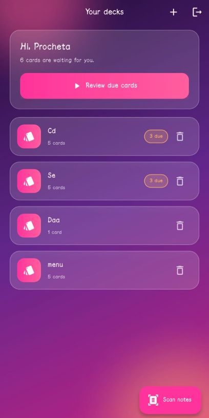
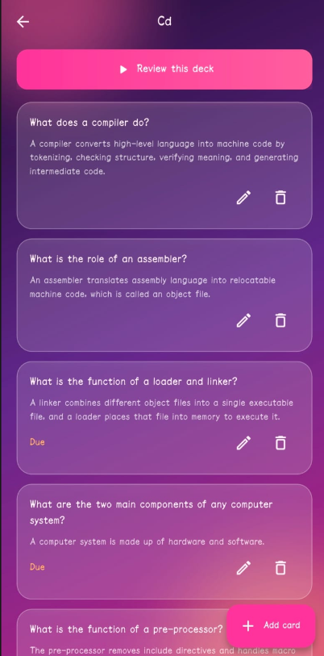
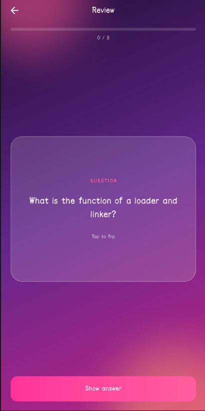
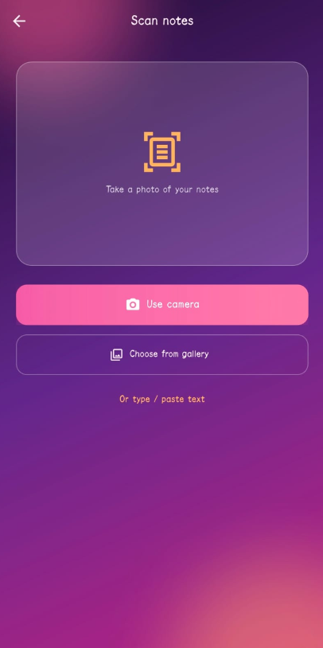

# Memora

Scan your notes, get flashcards, never forget.

Memora is a Flutter app that turns photos or text of your notes into flashcards using AI, then schedules reviews with spaced repetition (SM-2).

## Features

- Scan notes with the camera or gallery (on-device OCR with ML Kit)
- Generate flashcards from notes with Gemini
- Edit or remove generated cards before saving
- Decks and cards with full create, edit, and delete
- Spaced repetition review (Again, Hard, Good, Easy)
- Login and signup with JWT
- Glassmorphism UI with a sunset theme

## Tech stack

- App: Flutter, Provider, ML Kit text recognition, image_picker
- Backend: Node.js, Express, MongoDB Atlas (Mongoose), JWT, bcrypt
- AI: Google Gemini API

## Project structure

```
memora/                 Flutter app
studybuddy-backend/     Node.js API
```

## Run the backend

1. Create a free cluster at MongoDB Atlas and get a connection string.
2. Get a free API key from Google AI Studio.
3. Set up and start the server:

```
cd studybuddy-backend
npm install
```

4. Copy `.env.example` to `.env` and fill in the values.
5. Start it:

```
npm run dev
```

The API runs on port 5000. Check `http://localhost:5000/api/health`.

## Run the app

1. Open `memora/lib/core/constants/api_constants.dart` and set `baseUrl` to your computer's IP, for example `http://192.168.1.10:5000/api`.
2. Your phone and computer must be on the same Wi-Fi.
3. Run:

```
cd memora
flutter pub get
flutter run
```

## API overview

| Method | Route | What it does |
| --- | --- | --- |
| POST | /api/auth/register | Create account |
| POST | /api/auth/login | Log in |
| GET, POST | /api/decks | List and create decks |
| PUT, DELETE | /api/decks/:id | Edit and delete a deck |
| GET | /api/decks/:id/cards | Cards in a deck |
| POST | /api/cards | Create a card |
| GET | /api/cards/due | Cards due for review |
| POST | /api/cards/:id/review | Submit a review rating |
| POST | /api/generate | Generate flashcards from text |

## Screenshots

<p>
  
  
  
  
</p>

